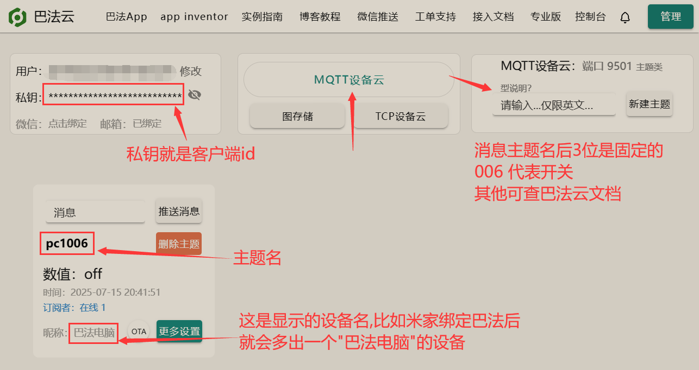
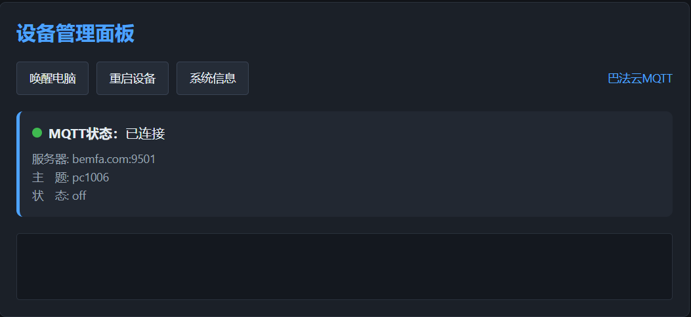

# 让语音助手开电脑

基于 Rust 编写的极简 Wake-on-LAN（网络唤醒）与 MQTT 客户端，专为低 ROM / RAM 的路由器等长期在线设备设计，零第三方依赖，二进制体积小、内存占用极低。

### 巴法云平台配置

使用巴法云 MQTT 服务即可远程控制开机，无需公网 IP，并支持接入小爱、小度、Google、亚马逊等主流语音平台（用手机语音助手即可控制，不强制需要音箱）：

```
米家app -> 添加第三方设备 -> "巴法"，绑定后所有小爱都能用（app，音箱，手环）
小度app -> 添加第三方设备 -> "巴法"
Google助理 -> 设备 -> "be home"
亚马逊Alexa -> 技能 -> "be home"
```

- [巴法云](https://cloud.bemfa.com/web/user/index)
- [巴法云 MQTT 控制台](https://cloud.bemfa.com/tcp/devicemqtt.html)

在配置文件中填写：

- `client_id`：你的巴法云私钥
- `topic`：消息主题
- 服务器地址和端口保持默认即可



### 配置文件

默认读取当前目录下的 `xiaoai.json`（也可通过命令行参数指定自定义路径）：

```json
{
  "port": 3030,
  "mac": "00-00-00-FF-FF-FF",
  "mqtt": {
    "client_id": "bemfa_private",
    "topic": "title",
    "server": "bemfa.com",
    "port": 9501
  }
}
```

- `port`：内网 Web 管理端口
- `mac`：需要唤醒的电脑 MAC 地址（支持 `-` 或 `:` 分隔）

MQTT 连接内置持续重连与心跳保活机制，无论启动时还是运行中遇到网络波动或服务端断开，都会自动按指数退避（2 秒起，最高 30 秒）持续重连并在恢复后自动重新订阅主题。

### 编译

`cargo build --release` 默认产出静态链接的 musl amd64 二进制，首次编译先安装对应 target：

```bash
rustup target add x86_64-unknown-linux-musl
cargo build --release
```

产物位于 `target/x86_64-unknown-linux-musl/release/xiaoai-wol`，不依赖系统 glibc，可直接在任意 x86_64 Linux 上运行。针对路由器常见的 ARM 架构同样可交叉编译为 Linux 静态二进制，先安装 target 再编译：

```bash
rustup target add aarch64-unknown-linux-musl armv7-unknown-linux-musleabihf
cargo build --release --target aarch64-unknown-linux-musl
cargo build --release --target armv7-unknown-linux-musleabihf
```

仓库内的 `.cargo/config.toml` 已将 `x86_64-unknown-linux-musl` 设为默认构建目标，并为 amd64 与这两个 ARM musl 目标指定 Rust 工具链自带的 `rust-lld` 作为链接器，无需额外安装交叉编译工具链。交叉编译产物位于 `target/<target>/release/xiaoai-wol`，例如 `target/aarch64-unknown-linux-musl/release/xiaoai-wol`。

MIPS 小端（`mipsel`，Go 中写作 `mipsle`，常见于 MT7620 / MT7621 等路由器）对应 target `mipsel-unknown-linux-musl`。该目标在 Rust 属于 Tier 3，rustup 不提供预编译标准库，需要 nightly 从源码构建标准库，并自备 mipsel 的 musl 交叉工具链提供 libc 与 crt 启动文件：

```bash
rustup toolchain install nightly --profile minimal --component rust-src

# 从 https://musl.cc 下载 mipsel-linux-musl-cross.tgz 并解压
export MIPSEL_MUSL=/opt/mipsel-linux-musl-cross

export CARGO_TARGET_MIPSEL_UNKNOWN_LINUX_MUSL_LINKER="$MIPSEL_MUSL/bin/mipsel-linux-musl-gcc"
export CARGO_TARGET_MIPSEL_UNKNOWN_LINUX_MUSL_RUSTFLAGS="-C link-self-contained=no -C target-feature=+crt-static"

cargo +nightly build --release -Z build-std=std,panic_abort --target mipsel-unknown-linux-musl
```

`link-self-contained=no` 让链接阶段改用工具链自带的 crt 与 libc；环境变量只作用于该 target，与仓库中 amd64 / ARM 目标的 `rust-lld` 配置互不影响。若报 `unable to find library -lunwind`，把工具链中的 `libgcc_eh.a` 软链为 `libunwind.a` 并放入链接搜索路径即可。

产物位于 `target/mipsel-unknown-linux-musl/release/xiaoai-wol`，`readelf -h` 应显示机器类型 MIPS。该目标固定 `mips32r2` 指令集、软浮点、o32 ABI。

### 用法

将可执行程序与 `xiaoai.json` 放在同一目录。

Windows 直接运行：

```bash
xiaoai-wol.exe
```

Linux 进入程序目录并赋予执行权限：

```bash
chmod +x xiaoai-wol
```

试运行检查日志（`Ctrl+C` 退出）：

```bash
./xiaoai-wol
```

确认正常后放后台运行：

```bash
nohup ./xiaoai-wol > /dev/null 2>&1 &
```

无 `nohup` 的看有没有 `setsid` 或 `start-stop-daemon`：

```bash
busybox --list | grep -E 'setsid|start-stop-daemon'
setsid ./xiaoai-wol </dev/null >/dev/null 2>&1 &
start-stop-daemon -S -b -x /path/xiaoai-wol-arm64 -- /path/xiaoai.json
```

如需开机自启，可将命令加入路由器启动脚本。

运行后在内网打开 `http://<设备IP>:<端口>` 即可访问管理面板（仅允许内网地址访问）：



- `唤醒电脑`：手动向内网广播 WOL 魔术包
- `重启设备`：重启当前程序所在设备（如路由器）
- `系统信息`：查看设备 CPU、内存及当前进程资源占用
- `MQTT状态`：实时显示连接状态、服务器、主题及当前开关状态；收到 `on` 会立即唤醒电脑并在 5 秒后自动回发 `off` 还原开关状态
